# NK STORE — loja virtual de camisas de futebol

Loja virtual completa, com catálogo, carrinho, checkout com **Mercado Pago (Checkout Pro)**, cálculo de frete por CEP e
**painel administrativo**, feita com Next.js 16, TypeScript, Prisma e Tailwind CSS.

O projeto partiu de um pedido real de cliente (99Freelas) e foi feito como **peça de portfólio**. Ele funciona como uma
loja pronta para vender, mas roda com **dados de demonstração e credenciais de teste**.

> **Catálogo demonstrativo.** Times, camisas e imagens são **fictícios**: as ilustrações são SVGs gerados por código
> (`prisma/jersey-svg.ts`), sem escudos, logos, nomes oficiais de clubes ou fotos protegidas. Os pagamentos usam o
> ambiente de testes do Mercado Pago.

---

## Sumário

- [Prints](#prints)
- [Funcionalidades](#funcionalidades)
- [Stack](#stack)
- [Como rodar](#como-rodar)
- [Variáveis de ambiente](#variáveis-de-ambiente)
- [Testar o pagamento no sandbox](#testar-o-pagamento-no-sandbox)
- [Testes automatizados](#testes-automatizados)
- [Qualidade: acessibilidade e performance](#qualidade-acessibilidade-e-performance)
- [Deploy na Vercel](#deploy-na-vercel)
- [Decisões técnicas](#decisões)
- [Estrutura de pastas](#estrutura-de-pastas)
- [Checklist](#checklist)

---

## Prints

| Home (desktop) | Home (celular) |
|---|---|
| 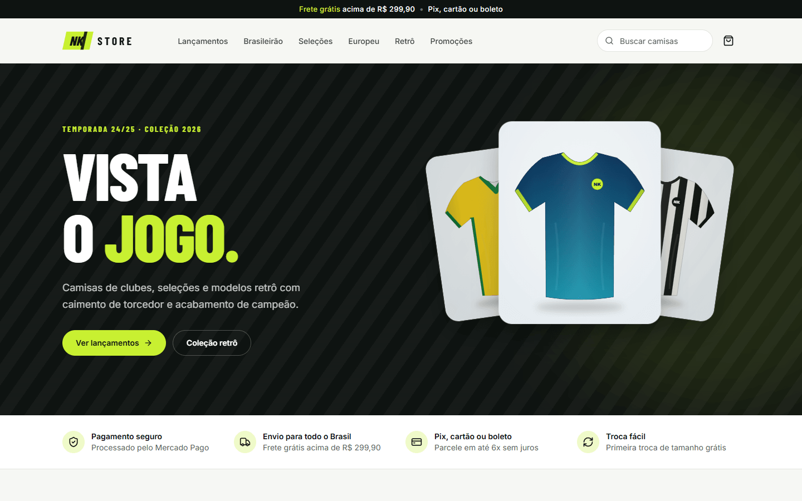 | 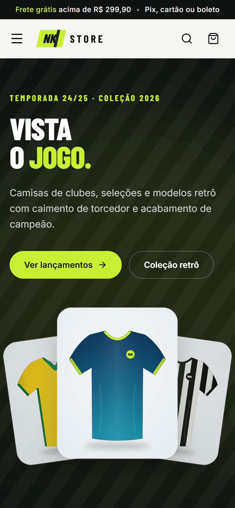 |

| Catálogo com filtros | Produto: tamanhos, estoque e frete |
|---|---|
| 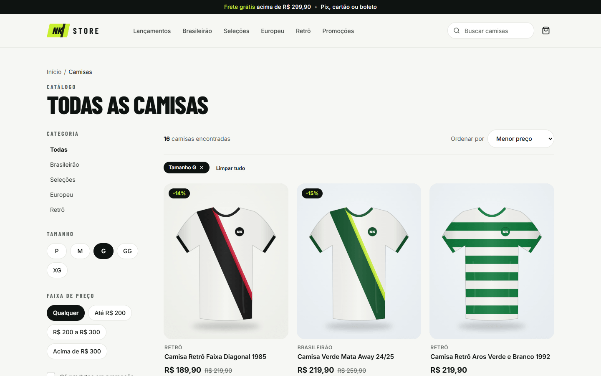 | 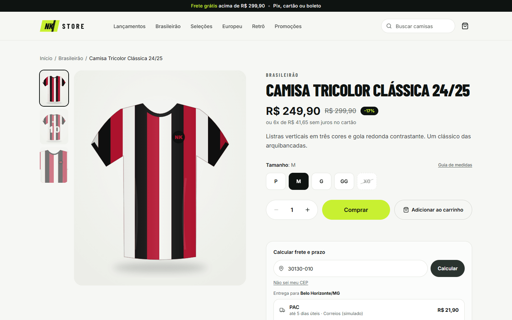 |

| Carrinho | Checkout |
|---|---|
| 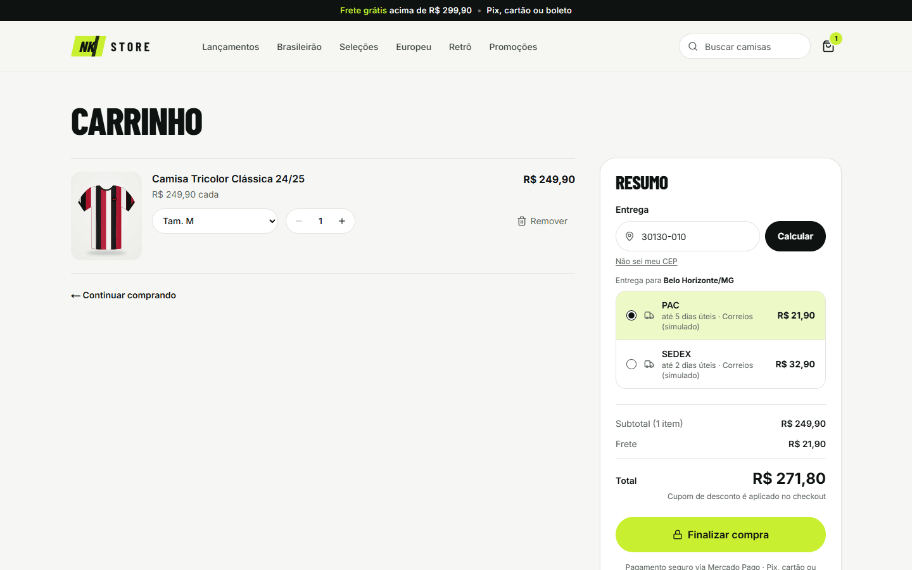 | 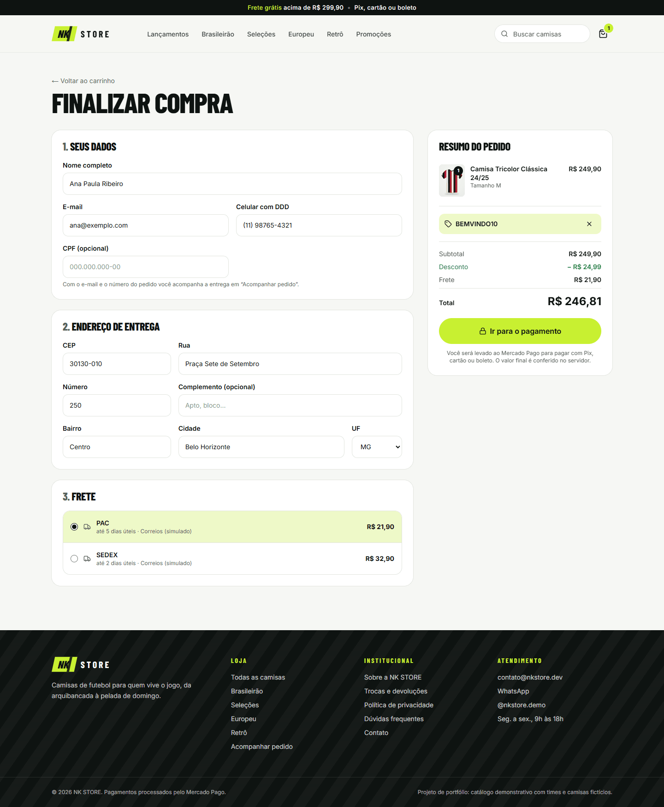 |

| Painel: dashboard | Painel: pedido |
|---|---|
| 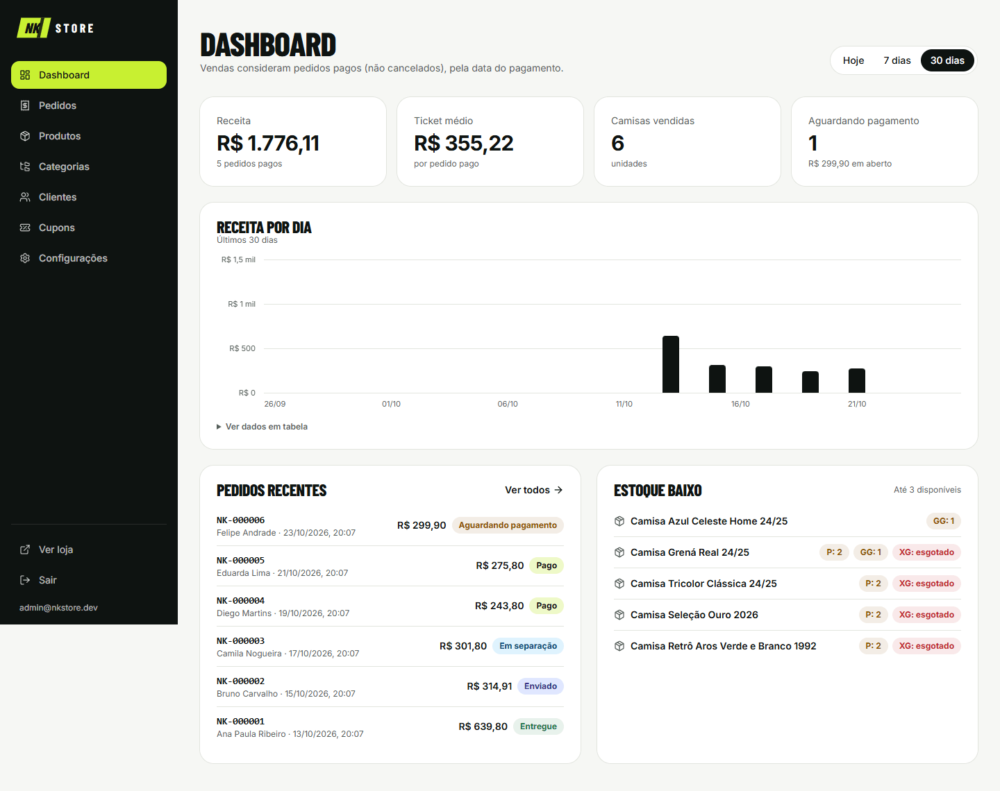 | 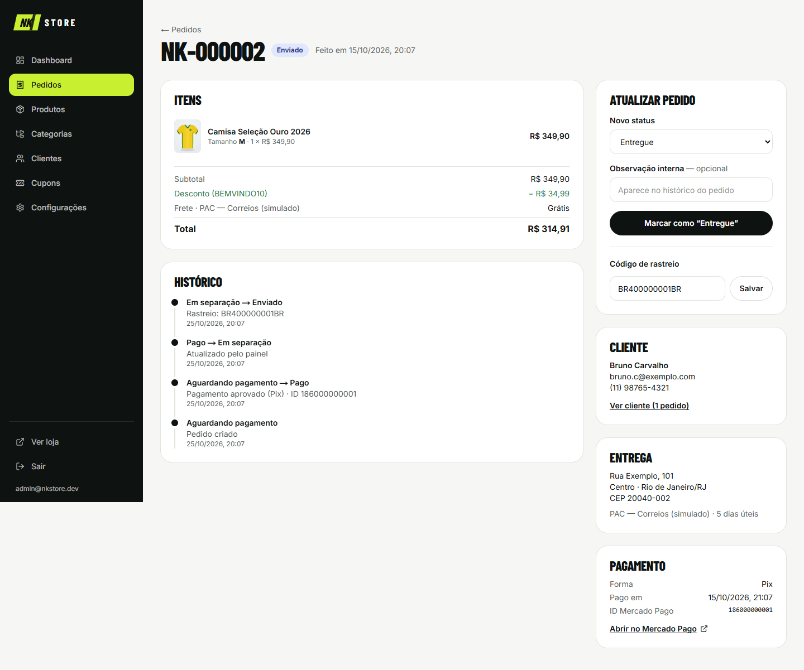 |

<details>
<summary>Mais prints (painel e celular)</summary>

| | |
|---|---|
| 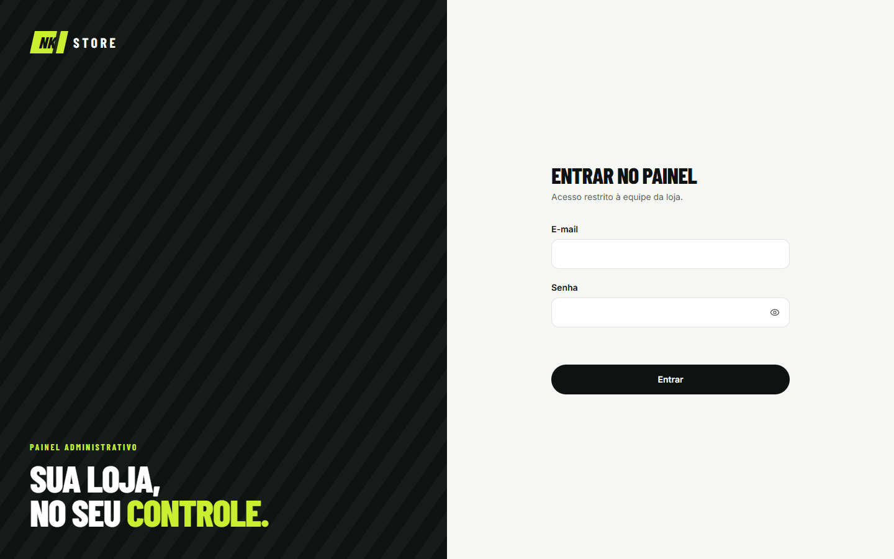 | 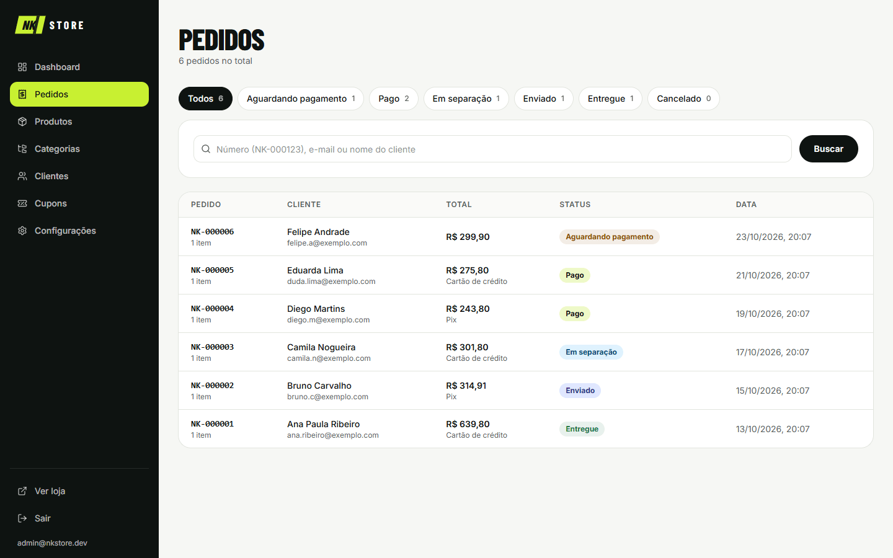 |
| 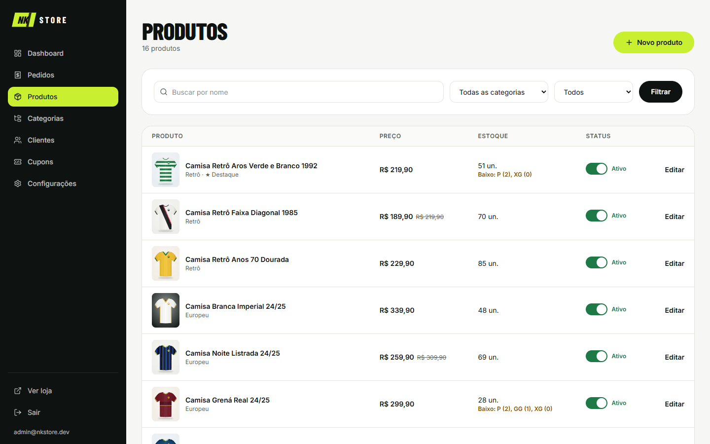 | 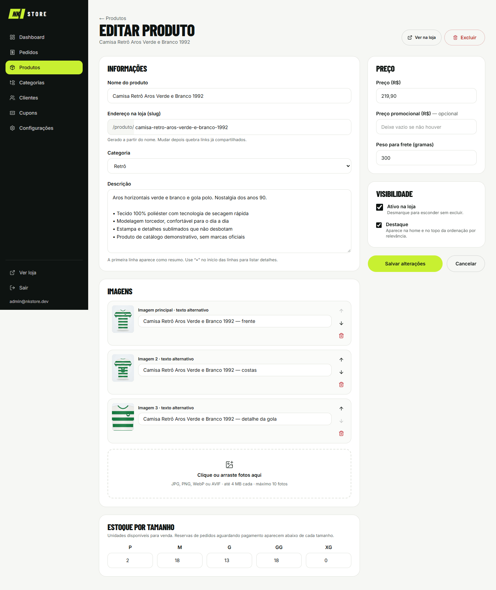 |
| 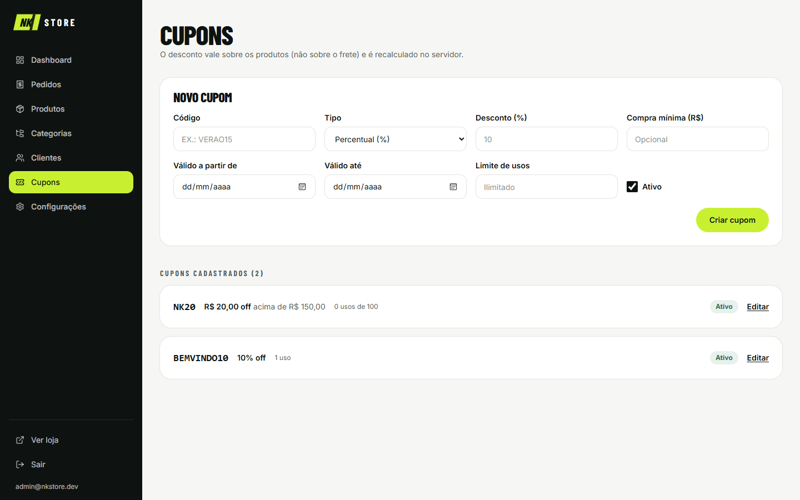 | 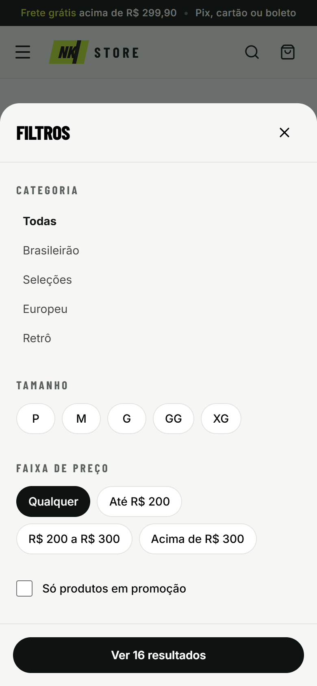 |
| 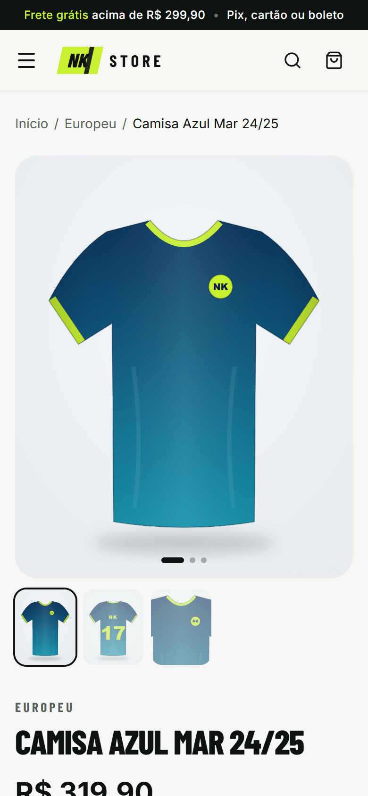 | |

</details>

---

## Funcionalidades

### Loja
- **Home** com hero, selos de confiança, categorias, destaques e lançamentos.
- **Catálogo** com filtros por categoria, tamanho, faixa de preço e promoção, além de ordenação, busca sem acento
  ("selecao" encontra "Seleção") e paginação. No celular, os filtros abrem num painel inferior.
- **Página de produto:**
  - galeria que desliza com o dedo no celular e tem miniaturas no desktop;
  - tamanhos P a XG com **estoque por tamanho** e aviso de "últimas unidades";
  - quantidade, guia de medidas e **cálculo de frete por CEP** na própria página.
- **Carrinho** persistente (`localStorage`, sincronizado entre abas). Dá para trocar tamanho, alterar quantidade e
  remover itens, e preços e estoque são **revalidados no servidor**.
- **Checkout:**
  - endereço preenchido pelo **ViaCEP**, máscaras e validação de CPF;
  - escolha do frete e **cupom de desconto**;
  - redirecionamento ao **Mercado Pago** (Pix, cartão ou boleto).
- **Páginas de retorno** (sucesso, pendente, falha), com opção de **tentar pagar de novo usando o mesmo pedido**.
- **Acompanhar pedido** por número + e-mail, com linha do tempo e código de rastreio.
- Páginas **Sobre, Trocas e devoluções, Política de privacidade, Contato e FAQ**.
- **SEO:**
  - metadados por página, URLs amigáveis, `sitemap.xml` e `robots.txt`;
  - **imagens Open Graph geradas** para o site e para cada produto;
  - dados estruturados (Product, FAQPage, OnlineStore e busca interna).

### Painel administrativo (`/admin`)
- **Login** com e-mail e senha (bcrypt). Depois de 5 tentativas erradas, o acesso fica bloqueado por 15 minutos.
- **Dashboard:** receita, ticket médio, camisas vendidas e pedidos em aberto (hoje / 7 / 30 dias), gráfico de receita
  por dia com tabela acessível, pedidos recentes e estoque baixo.
- **Produtos:**
  - criar, editar, ativar/desativar e excluir;
  - **upload de várias imagens** com ordem e texto alternativo;
  - preço e preço promocional, peso para frete e **estoque por tamanho**.
- **Categorias:** CRUD com ordem de exibição.
- **Pedidos:**
  - filtros por status e busca;
  - mudança de status (Pago → Em separação → Enviado → Entregue, ou Cancelado);
  - **código de rastreio**, histórico completo e botão "verificar pagamento no Mercado Pago".
- **Clientes:** lista com total comprado e histórico de pedidos.
- **Cupons:** percentual ou valor fixo, compra mínima, validade e limite de usos.
- **Configurações:** nome, logo, contatos, CEP de origem e regra de frete grátis. **Credenciais nunca vão para o banco
  nem para a tela.**

### Regras de negócio
- O pedido **só vira "Pago" quando o Mercado Pago confirma**, e o pagamento é sempre **consultado na API** do Mercado
  Pago, nunca aceito a partir do navegador ou do conteúdo da notificação.
- **Estoque reservado ao criar o pedido e baixado só no pagamento confirmado.** Reservas não pagas expiram em 72 horas.
- **Preços, frete e cupom são recalculados no servidor.** O navegador envia apenas ids e quantidades.
- Número de pedido legível: **NK-000123**.

---

## Stack

| Camada | Tecnologia |
|---|---|
| Framework | **Next.js 16** (App Router, Server Components, Server Actions, Turbopack) + **React 19** |
| Linguagem | **TypeScript** (strict) |
| Estilo | **Tailwind CSS 4**, componentes próprios, ícones `lucide-react`, fontes Barlow Condensed + Inter (`next/font`) |
| Banco | **Prisma 7** + **SQLite** (dev) e **PostgreSQL/Neon** (produção), escolhidos pela `DATABASE_URL` |
| Autenticação | **NextAuth (Auth.js) v4**, credenciais + **bcrypt**, sessão JWT |
| Pagamento | **Mercado Pago Checkout Pro**, SDK oficial `mercadopago` v3, com webhook |
| Frete | Interface única de provedor, com **frete simulado** por região do CEP (Melhor Envio plugável) |
| Endereço | **ViaCEP** |
| Validação | **Zod 4** em todas as entradas |
| Uploads | Pasta local (dev) ou **Vercel Blob** (produção) |
| Testes | **Vitest** (53 testes) |

---

## Como rodar

**Pré-requisitos:** Node.js 20.9 ou superior (testado no 24) e Git.

```bash
git clone <url-do-repositorio> nk-store
cd nk-store
cp .env.example .env        # no Windows (PowerShell): copy .env.example .env
```

Edite o `.env` e preencha pelo menos:

```ini
NEXTAUTH_SECRET="uma-string-longa-e-aleatória"   # gere com o comando abaixo
SEED_ADMIN_EMAIL="admin@nkstore.dev"
SEED_ADMIN_PASSWORD="uma-senha-com-8+-caracteres"
```

Para gerar um segredo aleatório:

```bash
node -e "console.log(require('crypto').randomBytes(32).toString('base64'))"
```

Depois:

```bash
npm install && npx prisma migrate dev && npm run seed && npm run dev
```

- Loja: **http://localhost:3000**
- Painel: **http://localhost:3000/admin**, com o e-mail e a senha que você definiu no `.env`

O seed é idempotente (pode rodar de novo) e cria 1 admin, 4 categorias, 16 produtos com estoque por tamanho, 2 cupons
(`BEMVINDO10` e `NK20`) e as configurações da loja.

> **Sem as chaves do Mercado Pago**, a loja inteira funciona, mas o botão de pagamento mostra "Pagamento indisponível".
> Veja [Testar o pagamento no sandbox](#testar-o-pagamento-no-sandbox).

### Scripts

| Comando | O que faz |
|---|---|
| `npm run dev` | Servidor de desenvolvimento |
| `npm run build` / `npm start` | Build e servidor de produção |
| `npm run seed` | Popula o banco com os dados de demonstração |
| `npm run demo:reset -- --confirmar` | Restaura a loja de demonstração (apaga pedidos e produtos criados) |
| `npm run db:pg:sync` | Atualiza o schema do PostgreSQL a partir do principal |
| `npm test` | Testes automatizados (usa um banco SQLite próprio) |
| `npm run lint` / `npm run typecheck` | ESLint e checagem de tipos |

---

## Variáveis de ambiente

Todas estão documentadas em [`.env.example`](.env.example). **Nenhuma credencial real fica no repositório**: o `.env` está
no `.gitignore`.

| Variável | Obrigatória | Descrição |
|---|---|---|
| `DATABASE_URL` | sim | `file:./prisma/dev.db` (SQLite) ou URL do PostgreSQL |
| `NEXT_PUBLIC_SITE_URL` | sim | URL pública da loja (usada nas URLs de retorno do pagamento, no sitemap e no Open Graph) |
| `NEXTAUTH_SECRET` / `NEXTAUTH_URL` | sim | Segredo da sessão do painel e URL base |
| `SEED_ADMIN_EMAIL` / `SEED_ADMIN_PASSWORD` | para o seed | Admin de demonstração (não há valores fixos no código) |
| `MP_ACCESS_TOKEN` / `NEXT_PUBLIC_MP_PUBLIC_KEY` | para pagar | Credenciais do Mercado Pago (**use as de teste**) |
| `MP_WEBHOOK_SECRET` | recomendada | Assinatura secreta exibida no painel de Webhooks do Mercado Pago |
| `MP_WEBHOOK_STRICT_SIGNATURE` | não | `true` recusa notificações com assinatura inválida (veja [Decisões](#decisões)) |
| `MP_NOTIFICATION_BASE_URL` | não | Se preenchida, cada pedido informa sua URL de notificação. Vazia = usa a URL do painel |
| `CRON_SECRET` | produção | Protege `/api/cron/diario` (Vercel Cron) |
| `DATABASE_URL_UNPOOLED` | com Neon | Conexão direta usada nas migrações (criada pela integração do Neon) |
| `DEMO_MODE` / `DEMO_ADMIN_EMAIL` / `DEMO_ADMIN_PASSWORD` | portfólio | Modo demonstração com reset diário (veja [Deploy](#modo-demonstração-portfólio-público)) |
| `SHIPPING_PROVIDER` | não | `simulado` (padrão). Interface pronta para `melhorenvio` |
| `MELHOR_ENVIO_TOKEN` / `MELHOR_ENVIO_ENV` / `MELHOR_ENVIO_USER_AGENT` | não | Reservadas para o provedor Melhor Envio |
| `STORAGE_DRIVER` | não | `local` (dev) ou `vercel-blob` (produção) |
| `BLOB_STORE_ID` ou `BLOB_READ_WRITE_TOKEN` | com Vercel Blob | Criado automaticamente ao conectar o Blob ao projeto da Vercel (conexões novas criam `BLOB_STORE_ID` e autenticam via OIDC) |

---

## Testar o pagamento no sandbox

### 1. Credenciais de teste
1. Em <https://www.mercadopago.com.br/developers/panel/app>, crie uma aplicação **Checkout Pro**, com **API de
   Preferences**.
2. Em **Contas de teste**, crie um **vendedor** e um **comprador**.
3. Copie as credenciais de teste (Access Token e Public Key) para `MP_ACCESS_TOKEN` e `NEXT_PUBLIC_MP_PUBLIC_KEY`.

> Para conferir se o token é de teste:
> `curl -H "Authorization: Bearer $MP_ACCESS_TOKEN" https://api.mercadopago.com/users/me`.
> A resposta deve conter `"test_user"` em `tags`.

### 2. URL pública (túnel) para o webhook
O Mercado Pago precisa alcançar a loja pela internet. Em desenvolvimento, use um túnel:

```bash
# Cloudflare Tunnel (grátis, sem cadastro). Windows: winget install --id Cloudflare.cloudflared
cloudflared tunnel --url http://localhost:3000
# ou: ngrok http 3000
```

1. Copie o endereço `https://….trycloudflare.com` para `NEXT_PUBLIC_SITE_URL` e reinicie o `npm run dev`.
2. No painel do Mercado Pago, em **Webhooks**, cadastre `https://SEU-TUNEL/api/webhooks/mercadopago` com o evento
   **Pagamentos**, e copie a assinatura secreta para `MP_WEBHOOK_SECRET`.
   - Com credenciais de usuário de teste, as notificações chegam como **"Modo de produção"**. Cadastre a URL nessa aba.
3. O endereço do túnel **muda a cada execução**. Atualize o `.env` e o painel sempre que reiniciar o túnel.

### 3. Comprar
1. Numa **janela anônima**, abra a loja **pelo endereço do túnel** e compre uma camisa.
2. No Mercado Pago, entre com o **comprador de teste** e pague com cartão de teste:

| Cartão | Número | Validade | CVV |
|---|---|---|---|
| Visa | `4235 6477 2802 5682` | `11/30` | `123` |
| Mastercard | `5031 4332 1540 6351` | `11/30` | `123` |

   - **Nome do titular** define o resultado: `APRO` (aprovado), `OTHE` (recusado), `CONT` (pendente).
   - CPF: `12345678909`.
3. Feche a aba logo que aprovar. Em segundos o pedido aparece como **Pago** em `/admin/pedidos`, confirmado **pelo
   webhook**.

> Na nossa validação, o Mastercard de teste foi recusado pelo próprio Mercado Pago ("não aceita este meio de
> pagamento"), e o Visa funcionou.

---

## Testes automatizados

```bash
npm test
```

São **53 testes** (Vitest) nas regras críticas. Os testes de banco usam um SQLite próprio (`prisma/test.db`), recriado a
cada execução, e **nunca tocam no `dev.db`**.

| Arquivo | O que garante |
|---|---|
| `tests/pricing.test.ts` | Total (subtotal − desconto + frete), cupom percentual/fixo, arredondamento, compra mínima, validade, limite de usos, desconto nunca maior que o subtotal |
| `tests/stock.test.ts` | Reserva só com unidades disponíveis, transação desfeita se faltar estoque, **duas compras simultâneas pela última unidade (só uma consegue)**, baixa no pagamento e liberação no cancelamento |
| `tests/webhook.test.ts` | Rota real do webhook com a API do MP simulada: pagamento aprovado → Pago + baixa de estoque, **idempotência**, valor divergente ignorado, notificação forjada ignorada, recusa mantém o pedido aberto, cancelamento libera a reserva, uso do cupom contado só no pagamento, assinatura estrita (401) |
| `tests/webhook-signature.test.ts` | Validação HMAC do `x-signature` (formato documentado, id em minúsculas, partes ausentes, segredo errado, proteção contra replay) |
| `tests/demo-reset.test.ts` | Reset da demonstração: recusa sem `DEMO_MODE`, apaga o que visitantes criaram, restaura catálogo, pedidos de exemplo (numeração NK-000001) e admin de demonstração |
| `tests/schema-sync.test.ts` | Schema do PostgreSQL idêntico ao principal e migração inicial com todas as tabelas |
| `tests/validators.test.ts` | Dinheiro, número do pedido, CPF, schema do checkout (o navegador **não consegue enviar preço**), frete grátis e frete simulado |

---

## Qualidade: acessibilidade e performance

**Acessibilidade.** A auditoria com **axe-core** (WCAG 2.1 A/AA + boas práticas) em 20 páginas da loja e do painel, no
desktop e no celular, termina com **0 violações**. Também foram adotados:
- foco visível em todos os elementos (contorno verde-limão com borda escura);
- link "Pular para o conteúdo";
- menus em `<dialog>` nativo, que prende o foco e fecha com Esc;
- textos alternativos em todas as imagens;
- contraste mínimo de 4,5:1;
- gráfico com tabela equivalente;
- `prefers-reduced-motion` respeitado.

**Performance** (Lighthouse, build de produção):

| Página | Celular (Perf / A11y / BP / SEO) | Desktop |
|---|---|---|
| Home | 93 / 100 / 100 / 100 | 100 / 100 / 100 / 100 |
| Produto | 93 / 100 / 100 / 100 | 100 / 100 / 100 / 100 |
| Catálogo | 92 / 100 / 100 / 100 | 100 / 100 / 100 / 100 |
| FAQ | 96 / 100 / 100 / 100 | 100 / 100 / 100 / 100 |

No celular, o Lighthouse simula 4G lento e CPU 4× mais lenta. O LCP fica em cerca de 3 s, e a maior parte vem do
JavaScript base do Next.js: até a página de FAQ, que não tem imagens, fica em 2,8 s. CLS = 0 em todas as páginas.

Técnicas usadas:
- páginas de catálogo e produto pré-geradas (ISR) e atualizadas sob demanda quando o painel salva;
- `next/image` com carregamento sob demanda, e `fetchPriority="high"` apenas na imagem de LCP;
- imagens do catálogo em SVG (5–6 KB cada);
- fontes auto-hospedadas.

---

## Deploy na Vercel

O SQLite não funciona na Vercel (sistema de arquivos somente leitura e efêmero). Em produção, o projeto usa
**PostgreSQL** ([Neon](https://neon.tech)) e **Vercel Blob** para as imagens, **sem mudar o código**:

- o `prisma.config.ts` olha a `DATABASE_URL` e escolhe sozinho o schema e as migrações certos: `prisma/` para SQLite e
  `prisma/postgres/` para PostgreSQL. Os modelos são os mesmos, e um teste garante que os dois schemas não divergem;
- o `src/lib/db-adapter.ts` escolhe o driver (`better-sqlite3` ou `pg`) pela mesma URL;
- o script `vercel-build` (`package.json`) aplica as migrações (`prisma migrate deploy`) a cada deploy.

> Alterou `prisma/schema.prisma`? Rode `npm run db:pg:sync` para atualizar `prisma/postgres/schema.prisma` e gere a
> migração do PostgreSQL com `npx prisma migrate dev` apontando para um banco PostgreSQL.

### 1. Projeto, banco e armazenamento
1. Em <https://vercel.com/new>, importe o repositório do GitHub. O framework (Next.js) é detectado sozinho.
2. No projeto, em **Storage**:
   - **Create Database → Neon (Postgres)** e conecte ao projeto. `DATABASE_URL` e `DATABASE_URL_UNPOOLED` são criadas
     sozinhas;
   - **Create → Blob** com acesso **Public** (fotos de produto são públicas; não dá para mudar depois) e conecte ao projeto. `BLOB_STORE_ID` (ou `BLOB_READ_WRITE_TOKEN`, em conexões antigas) é criada sozinha.

### 2. Variáveis de ambiente (Settings → Environment Variables)

```ini
NEXTAUTH_SECRET=...                 # string aleatória
NEXTAUTH_URL=https://sua-loja.vercel.app
NEXT_PUBLIC_SITE_URL=https://sua-loja.vercel.app
MP_ACCESS_TOKEN=...                 # teste ou produção
NEXT_PUBLIC_MP_PUBLIC_KEY=...
MP_WEBHOOK_SECRET=...
MP_WEBHOOK_STRICT_SIGNATURE=false   # true com credenciais reais, após confirmar que a assinatura confere
STORAGE_DRIVER=vercel-blob
CRON_SECRET=...                     # string aleatória
# só para o portfólio público:
DEMO_MODE=true
DEMO_ADMIN_EMAIL=demo@nkstore.dev
DEMO_ADMIN_PASSWORD=...
```

### 3. Dados iniciais
- **Portfólio (`DEMO_MODE=true`):** chame a tarefa diária uma vez para popular a loja:
  `curl -H "Authorization: Bearer $CRON_SECRET" https://sua-loja.vercel.app/api/cron/diario`.
  Depois disso, o **Vercel Cron** (`vercel.json`) repete o reset todo dia às 3h de Brasília.
- **Loja real:** rode `npm run seed` uma vez, da sua máquina, com a `DATABASE_URL` do Neon no `.env`. O seed cria o
  admin do `SEED_ADMIN_*` e o catálogo. Depois, cadastre os produtos reais pelo painel.

### 4. Mercado Pago
Cadastre o webhook `https://sua-loja.vercel.app/api/webhooks/mercadopago` (evento **Pagamentos**). Com credenciais de
usuário de teste, use a aba **Modo de produção** do painel de Webhooks.

### Modo demonstração (portfólio público)
Com `DEMO_MODE=true`:
- a tela de login do painel mostra o **acesso de demonstração** e um botão "Entrar como visitante";
- uma faixa avisa, na loja e no painel, que é uma demonstração, e o checkout mostra o **cartão de teste**;
- as **configurações da loja ficam travadas**, para ninguém trocar WhatsApp ou e-mail por links de terceiros;
- **todo dia às 3h** (`/api/cron/diario`), a loja volta ao estado inicial:
  - pedidos, clientes, cupons, produtos e categorias criados por visitantes são apagados;
  - fotos enviadas são removidas do Blob;
  - catálogo, configurações e 6 pedidos de exemplo são restaurados, com a numeração voltando para NK-000001.

O reset **se recusa a rodar** sem `DEMO_MODE=true`. No seu computador, para preparar uma apresentação, use
`npm run demo:reset -- --confirmar` (apaga os pedidos e produtos do `dev.db` e restaura a demonstração).

### Antes de vender de verdade
- Deixe  (ou remova a variável).
- Troque para as **credenciais de produção** do Mercado Pago e ligue `MP_WEBHOOK_STRICT_SIGNATURE=true`.
- Troque o rate limit em memória por **Upstash Redis** (veja [Decisões](#decisões)).
- Revise os textos de Trocas e Privacidade com os dados reais da empresa (CNPJ, endereço, prazos).

---

## Decisões

Quando algo era ambíguo, escolhi a opção mais simples e padrão de mercado.

### Arquitetura
- **NextAuth v4 (Auth.js):** é a versão estável. A v5 ainda está em beta. A sessão usa JWT, com checagem de admin no
  `proxy.ts` (o antigo middleware, renomeado no Next 16) **e de novo** em cada página, Server Action e API do painel.
- **Prisma 7 com driver adapter (`better-sqlite3`).** O SQLite não tem enum, então status, tamanho e tipo de cupom são
  `String`, validados por Zod e por constantes em `src/lib/constants.ts`. Isso funciona sem mudança no PostgreSQL.
- **Dois bancos, mesmo código:** SQLite no desenvolvimento (zero instalação) e PostgreSQL em produção. Como o Prisma
  não permite trocar o `provider` por variável de ambiente, há um segundo schema gerado
  (`prisma/postgres/schema.prisma`, via `npm run db:pg:sync`) com migrações próprias. Um teste garante que os dois não
  divergem.
- **Modo demonstração com reset diário** em vez de um painel "somente leitura": o visitante experimenta o fluxo
  completo (cadastrar produto, mudar status, criar cupom), e o Vercel Cron desfaz tudo uma vez por dia (o plano gratuito
  da Vercel permite cron diário).
- **Dinheiro sempre em centavos (Int)**, para não ter erro de arredondamento com ponto flutuante.
- **Campos derivados no produto** (`finalPrice` e `searchText`, sem acentos e em minúsculas): permitem ordenar por preço
  e buscar sem acento direto no banco. São recalculados sempre que o produto ou a categoria é salvo.
- **Catálogo com ISR (60 s) + revalidação sob demanda** quando o painel salva. O estoque exibido pode ter até 1 minuto
  de atraso, mas carrinho e checkout **sempre** conferem o estoque real.
- **Checkout sem conta de cliente** (padrão em lojas pequenas, reduz abandono). O cliente é identificado pelo e-mail, e o
  carrinho fica no `localStorage`. Como não há contas de cliente, não há "sincronizar o carrinho ao logar". Isso fica
  como melhoria futura.

### Estoque
- **Coluna `reserved`:** disponível = `stock − reserved`. O checkout **reserva**, o pagamento confirmado **baixa** (stock
  e reserved), e cancelamento ou expiração **libera** a reserva.
- **Cada movimentação é um único `UPDATE` com condição no `WHERE`** (ex.: `… WHERE stock - reserved >= qtd`). Se duas
  compras disputam a última unidade, só uma afeta a linha. Há teste automatizado para isso.
- **Reserva de 72 horas** (cobre o prazo do boleto), com a mesma data de expiração na preferência do Mercado Pago.
  Pedidos vencidos são cancelados a cada novo checkout, ao abrir o painel e pelo Vercel Cron.
- Se um pagamento for aprovado **depois** da expiração, a loja tenta baixar do estoque disponível. Sem estoque, o pedido
  fica cancelado e o histórico avisa para estornar.

### Pagamento (Mercado Pago)
- **Checkout Pro com API de Preferences**, com o SDK oficial `mercadopago` v3. A v2 dependia de uma versão vulnerável
  do `uuid`.
- **O pagamento é sempre consultado na API do Mercado Pago com o nosso Access Token.** Ele só é aplicado se existir na
  nossa conta, apontar para o pedido (`external_reference`) e tiver o **valor exato** do total calculado no servidor.
  O conteúdo da notificação e os parâmetros da URL de retorno nunca são usados como verdade.
- **Valor pago = `transaction_amount` + `shipping_amount`.** O Checkout Pro separa o frete. Não usamos
  `total_paid_amount` porque ele inclui juros de parcelamento. *(Descoberto em teste: a primeira compra foi recusada
  pela trava de valor até a correção.)*
- **Assinatura do webhook (`x-signature`).** No sandbox com usuários de teste, as notificações chegam assinadas com uma
  chave **diferente** da "assinatura secreta" exibida no painel. Validamos o algoritmo documentado contra notificações
  reais e nenhuma variação conferia. Por isso:
  - **padrão:** assinatura inválida só gera aviso no log, e o pagamento continua verificado na API. Uma notificação
    forjada, no máximo, faz a loja consultar o Mercado Pago à toa, e o endpoint tem rate limit;
  - **`MP_WEBHOOK_STRICT_SIGNATURE=true`:** recusa (401) assinaturas inválidas. É recomendado em produção com
    credenciais reais, depois de confirmar que a assinatura confere.
- **`notification_url` por pedido é opcional.** Por padrão vale a URL cadastrada no painel, que é a forma documentada.
- **A página de retorno também consulta o pagamento** (pelo `payment_id`) na API e aplica o resultado. Isso ajuda quando
  o webhook ainda não chegou. Tudo é **idempotente**: webhook e retorno juntos não duplicam baixa de estoque nem uso de
  cupom.
- **Cupom no Mercado Pago:** como o Checkout Pro não aceita item com preço negativo, um pedido com desconto vai como
  **um item agregado** com o valor já descontado. Sem desconto, os itens vão detalhados.
- **"Pago" nunca é manual no painel.** Se um aviso se perder, o botão "Verificar pagamento no Mercado Pago" busca os
  pagamentos do pedido na API.
- **"Até 6x sem juros"** na vitrine é ilustrativo. A preferência limita a 6 parcelas, mas quem define se há juros é a
  configuração da conta Mercado Pago do vendedor.

### Frete
- **Interface única de provedor** (`src/lib/shipping/types.ts`). A implementação atual é a **simulada**: tabela por
  região postal (1º dígito do CEP), com PAC e SEDEX e acréscimo por peso. Isso atende o pedido ("se não houver token,
  frete simulado"). O provedor do **Melhor Envio** entra como uma nova classe que implementa a mesma interface, sem
  mudar o resto do código (ver Checklist).
- **Frete grátis:** acima do valor configurado, a opção mais barata fica gratuita.
- O frete é **recotado no servidor** ao criar o pedido, e a opção escolhida precisa existir na nova cotação.

### Segurança e outros
- **Rate limit em memória** (login, checkout, cupom, frete, CEP, rastreio, webhook). Na Vercel cada instância tem a
  própria memória, então para um limite global troque por **Upstash Redis** (`@upstash/ratelimit`), mantendo a mesma
  função `rateLimit()`.
- **Anti-enumeração de pedidos:** o número sequencial nunca dá acesso sozinho. O acompanhamento exige **número + e-mail**
  (com resposta genérica), e as páginas de retorno usam um **token aleatório** de 192 bits, com `<meta name="referrer"
  content="no-referrer">` para o link não vazar para outros sites.
- **Uploads:** o tipo é conferido pelos **bytes do arquivo** (JPG, PNG, WebP e AVIF; **SVG é recusado** porque pode
  conter script), com limite de 4 MB. Em dev, os arquivos ficam em `storage/uploads` e são servidos pela rota
  `/uploads/[arquivo]`, já que o Next só serve de `public/` o que existia no build. Em produção, Vercel Blob.
- **npm 11:** os scripts de instalação ficam bloqueados por padrão. Os pacotes liberados estão em `allowScripts` no
  `package.json` (better-sqlite3, prisma, @prisma/engines, esbuild e unrs-resolver).
- **E-mails transacionais** (confirmação de pedido) não estão implementados. O acompanhamento é pelo site.
- **Contato** mostra os canais (WhatsApp, e-mail, Instagram) em vez de um formulário, porque não há envio de e-mail.
- **Gráfico do dashboard** feito com HTML/CSS (sem biblioteca), com tabela equivalente para leitores de tela.

---

## Estrutura de pastas

```
prisma/
  schema.prisma        modelo de dados
  migrations/          migrações (SQLite)
  seed.ts              dados de demonstração
  jersey-svg.ts        gerador das camisas fictícias em SVG
public/products/       imagens SVG do catálogo
src/
  app/
    (loja)/            loja: home, produtos, categoria, produto, carrinho, checkout,
                       pedido/[status], acompanhar-pedido, páginas institucionais
    admin/             login e painel (dashboard, pedidos, produtos, categorias,
                       clientes, cupons, configurações)
    api/               checkout, frete, cep, cupom, carrinho, webhooks/mercadopago,
                       cron/diario, admin/upload, auth
    sitemap.ts, robots.ts, opengraph-image.tsx, icon.svg
  components/          loja/, admin/ e componentes comuns
  lib/
    orders.ts          criação de pedido, pagamento verificado, status e cancelamento
    stock.ts           reservar / confirmar / liberar estoque (SQL atômico)
    pricing.ts         totais e cupom (funções puras)
    payments/          Mercado Pago (preferência, consulta) e assinatura do webhook
    shipping/          interface de frete + provedor simulado
    storage/           upload local ou Vercel Blob
    validators/        schemas Zod
  proxy.ts             proteção de /admin e /api/admin
tests/                 Vitest
docs/prints/           capturas de tela deste README
```

---

## Checklist

### ✅ Pronto
- [x] Loja responsiva (mobile first) com home, catálogo, filtros, busca, ordenação e paginação
- [x] Página de produto com galeria, tamanhos P–XG, estoque por tamanho e frete por CEP
- [x] Carrinho persistente com revalidação no servidor
- [x] Checkout com ViaCEP, frete, cupom e Mercado Pago Checkout Pro (Pix, cartão e boleto)
- [x] Webhook com verificação na API, idempotência e assinatura (modo estrito opcional)
- [x] Reserva e baixa de estoque à prova de venda acima do estoque
- [x] Páginas de retorno, acompanhamento por número + e-mail e nova tentativa de pagamento
- [x] Painel: dashboard, produtos (com upload), categorias, pedidos (status + rastreio), clientes, cupons e configurações
- [x] Páginas institucionais, SEO completo e imagens Open Graph
- [x] 53 testes automatizados das regras críticas
- [x] Acessibilidade: 0 violações no axe-core. Lighthouse: 100 em A11y/BP/SEO
- [x] Modo demonstração para portfólio com reset diário automático
- [x] Compra testada de ponta a ponta no sandbox, com o pedido virando **Pago** só pelo webhook

### 🔜 Melhorias futuras
- [ ] **Provedor Melhor Envio** (sandbox) implementando a interface de frete existente
- [ ] **E-mails transacionais** (confirmação, envio com rastreio), ex.: Resend
- [ ] **Contas de cliente** com histórico e carrinho sincronizado ao logar
- [ ] Rate limit distribuído com **Upstash Redis** para produção serverless
- [ ] Busca sem diferenciar maiúsculas no painel ao usar PostgreSQL (`mode: "insensitive"`, que o SQLite não suporta)
- [ ] Testes de ponta a ponta (Playwright) no fluxo de compra
- [ ] Exclusão de imagens órfãs do armazenamento ao remover fotos de um produto
- [ ] Integração de etiqueta e rastreio automático com a transportadora
- [ ] Avaliações de produto e lista de desejos

---

Projeto de portfólio. Catálogo, marcas e pagamentos são fictícios ou de teste.
